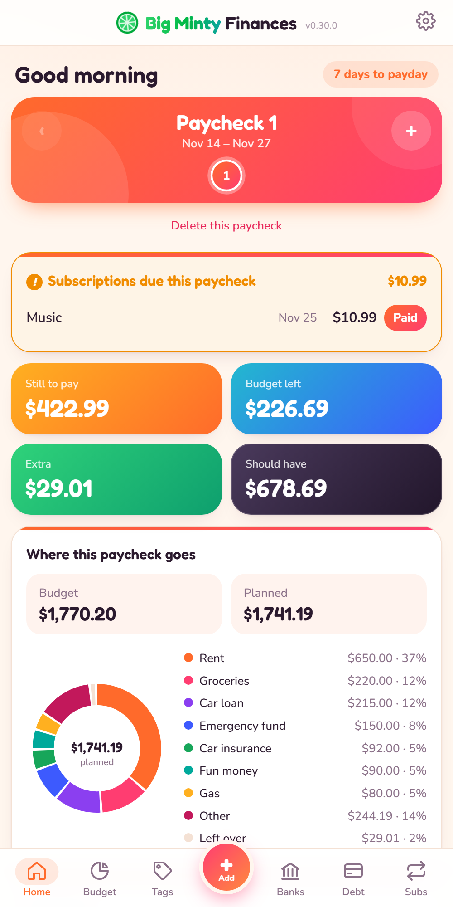
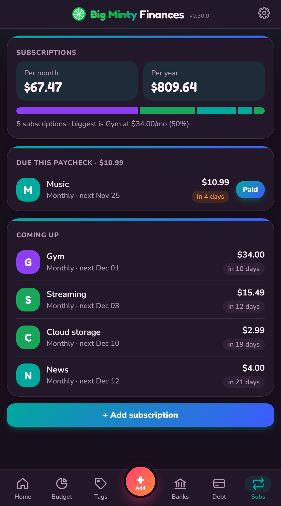

# Big Minty Finances

Paycheck-by-paycheck budgeting in your browser. Every paycheck gets its own budget, and bills, loan payments and
subscriptions land in the paycheck they are due in, so you always see what is still to pay and what is left. Includes
spending tags, bank accounts, credit cards and loans, subscriptions with reminders, backups and optional sync.

Part of the Big apps, with [Big Saucy Recipes](https://github.com/dontdoubtdusty/cooking),
[Big Skinny Health](https://github.com/dontdoubtdusty/diet), [Big Tidy Reminders](https://github.com/dontdoubtdusty/reminders),
[Big Shiny Rounds](https://github.com/dontdoubtdusty/cleaning) and [Big Healthy Habits](https://github.com/dontdoubtdusty/habits);
[Big Juicy Suite](https://github.com/dontdoubtdusty/suite) holds them all in one place.

## Install

1. Open https://dontdoubtdusty.github.io/budget/ in your browser.
2. Add it to your home screen:
   - iPhone or iPad (Safari): tap **Share**, then **Add to Home Screen**.
   - Android (Chrome): tap the menu, then **Install app** (or **Add to Home screen**).
   - Computer (Chrome or Edge): click the install icon at the right end of the address bar.
3. Open it from the new icon. It runs full screen and works without internet.

On iPhone, the home-screen app and the same page in Safari keep separate data. Pick one and stick with it, or move
your data with a backup.

Updates: nothing to do. The app checks for a newer copy each time it opens online.

Uninstall: remove the icon, then clear the site data for `dontdoubtdusty.github.io` in your browser settings. Make a
backup first (**Settings > Download backup**) if you want to keep your budget.

## Usage

The bar at the bottom has Home (still to pay, budget left and what is left this paycheck), Budget, Tags, Add (log
spending, card charges and income quickly), Banks, Debt and Subs. The gear at the top opens Settings: theme (light,
dark, automatic, or Day/Night, dark from 6pm to 6am), haptics, backups, logged paychecks and sync. Everything saves
as you go.

To move your budget to another device or browser, use **Settings > Share backup** (or **Download backup**) there and
**Import backup file** here, or sign in under **Settings > Sync across devices** on both.

## Known limits

- Your data lives only in this browser on this device until you back it up or turn on sync. Clearing site data
  deletes it.
- Sync keeps a copy of your budget in the Big apps' Firebase database under your account; it is off until you sign in.
- Deleted paychecks kept under **Settings > Logged paychecks** are read-only and removed six months after their pay
  date, on purpose.
- The take-home pay estimate is a rough guide, not tax advice.
- Sign-in, sync and the first load need internet; everything else works offline.
